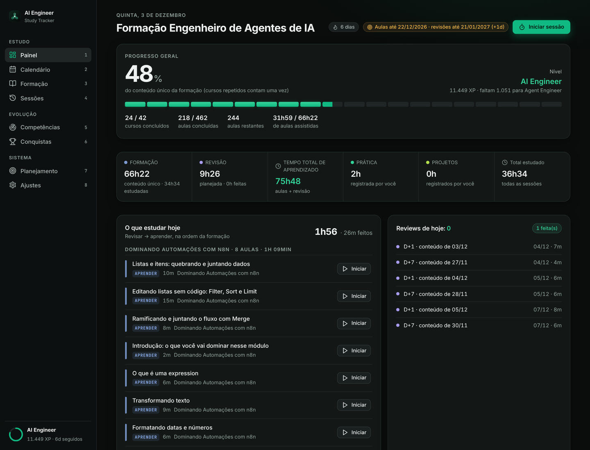
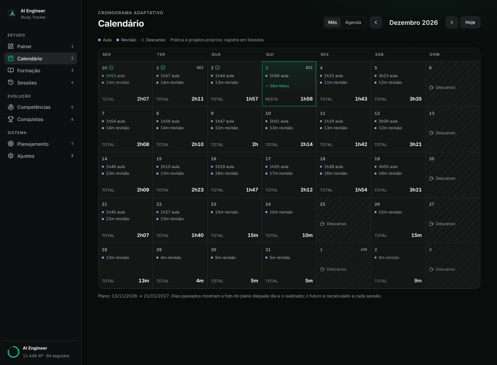
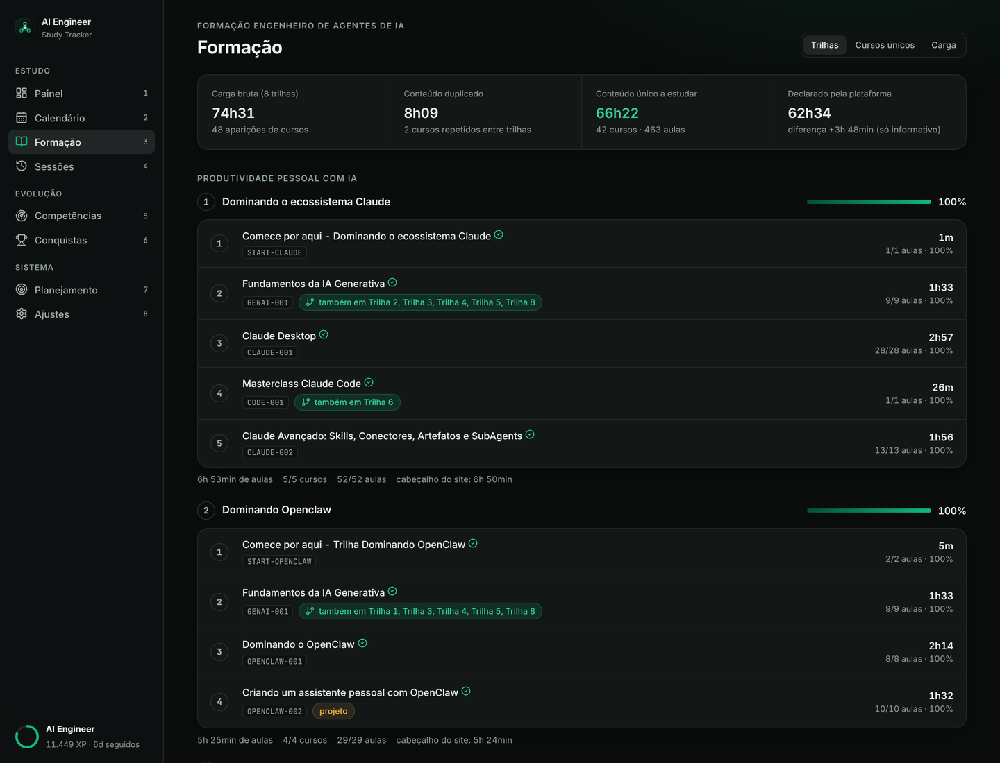
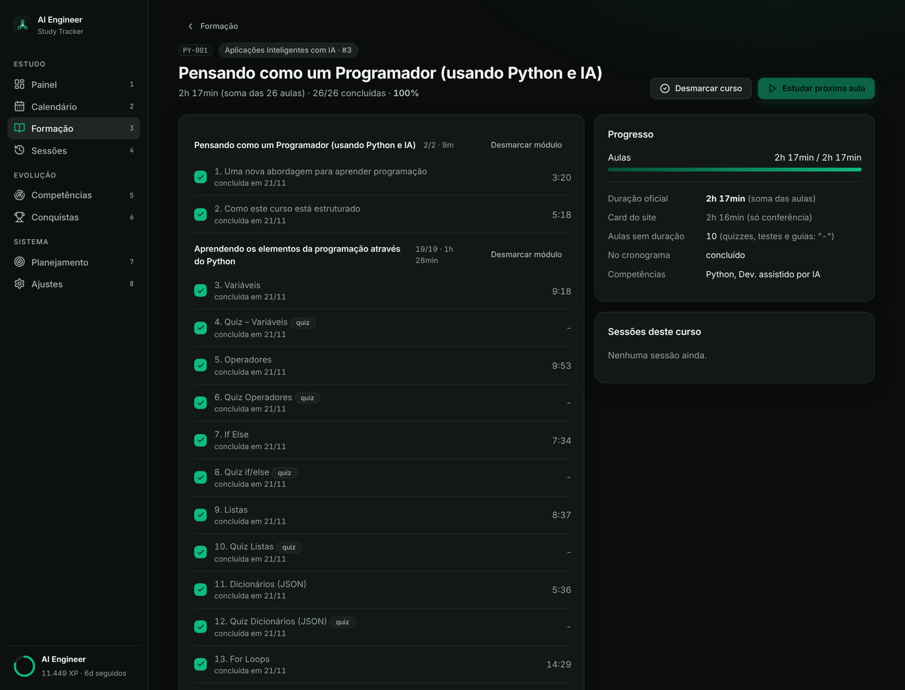
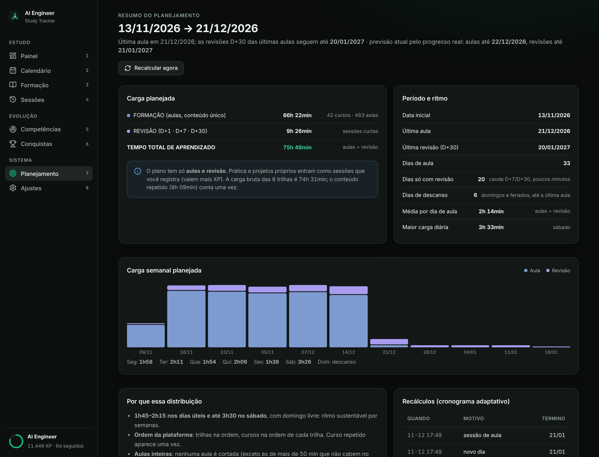

# AI Engineer Study Tracker

App pessoal e **local-first**, só para desktop (Windows), para **controlar os estudos** da formação
**Engenheiro de Agentes de IA**: Formação → Trilhas → Módulos → Aulas.



| | |
|---|---|
|  |  |
|  |  |

> Os prints usam um banco de **demonstração** (`scripts/demo_seed.py`), não dados reais.

## O catálogo (fonte: player da plataforma)

| | |
|---|---|
| Trilhas | 8 (2 grupos: *Produtividade pessoal com IA* e *Criando sistemas profissionais de inteligência artificial*) |
| Cursos únicos · aulas | 42 · 463 |
| Carga bruta (soma das 8 trilhas) | 74h30m39s (48 aparições de cursos) |
| Duplicado | 8h09m02s (*Fundamentos da IA Generativa* em 6 trilhas, *Masterclass Claude Code* em 2) |
| **Conteúdo único a estudar** | **66h21m37s** (soma das durações das aulas) |
| Declarado pela plataforma | 62h34 (só informativo; diferença +3h47) |

Regras: a duração de um curso é a **soma das aulas**; aula sem duração no player aparece como **"-"** e conta 0 min
(56 itens: quizzes, testes e guias); módulo sem título vira "Módulo N"; **eletivos ficam de fora**
(Projetos para Professores, Para se aprofundar, *Git e GitHub*). **Curso repetido tem um cadastro só:** concluir
uma aula, um módulo ou o curso vale em todas as trilhas.

## Cronograma (só aulas + revisão)

Início 13/11/2026 · **aulas até 21/12/2026** · revisões D+30 até 20/01/2027 · 33 dias de aula · 6 de descanso ·
média 2h14 por dia de aula · maior dia 3h33. Formação 66h22 + revisão 9h26 = **75h48** de aprendizado.
Rotina: Seg/Ter/Qui 2h15 · Qua 2h · Sex 1h45 · Sáb 3h30 · Dom descanso. Dia a dia em [`docs/CRONOGRAMA.md`](docs/CRONOGRAMA.md).

Prática e projetos próprios **não** entram no plano automático: você os registra como sessões (valem mais XP).
O cronograma é adaptativo: recalcula só o futuro e preserva o histórico.

## Funcionalidades

Painel · Calendário · Formação (trilhas, cursos, módulos, aulas) · Sessões e **Focus Mode** · revisão espaçada
D+1/D+7/D+30 · XP, 6 níveis e 17 conquistas · mapa de competências (pontos de partida editáveis) ·
backup/restauração (.db) · exportação/importação (JSON) · PWA instalável no Windows com uso offline.

## 1. Instalação (Windows)

Pré-requisito: [Python 3.10+](https://www.python.org/downloads/) (marque **"Add python.exe to PATH"**).
Dê duplo clique em **`install.bat`**.

## 2. Execução e acesso

Duplo clique em **`start.bat`** → abre <http://localhost:8000>. O servidor escuta **só em 127.0.0.1** (este PC).
Atalhos: `1`–`8` navegam entre telas e `f` abre o Focus Mode.

## 3. Backup e restauração

- **`backup.bat`** → `database\backups\backup-AAAAMMDD-HHMMSS.db` (mantém os 30 mais recentes).
- **`restore.bat database\backups\backup-....db`** (feche o `start.bat` antes; cria backup de segurança).
- No app: Ajustes → Backup (.db), Restaurar, Exportar/Importar JSON (importar também cria backup de segurança).

## 4. Instalar como app (PWA)

Com o `start.bat` rodando, abra `localhost:8000` no Chrome ou Edge e clique no ícone **Instalar** da barra de endereço.

## Atualizar o catálogo

O catálogo é gerado por `scripts/build_catalog.py` → `data/catalog.json` (formato validado em `backend/app/catalog.py`).
Em Ajustes → Catálogo é possível importar um `catalog.json` novo; o progresso é preservado pelos IDs das aulas.

## Arquitetura

```
ai-study-tracker/
├── backend/app/   main.py (API) · planner.py (algoritmo, função pura) · tracker.py (progresso/recálculo)
│                  catalog.py · gamification.py · services.py · backup.py · settings.py · schema.sql
├── frontend/      PWA: HTML + CSS + JS (módulos ES, sem build), manifest, service worker, fontes e ícones locais
├── data/          catalog.json
├── database/      study_tracker.db e backups/ (não versionados)
├── docs/          ANALISE.md · CRONOGRAMA.md · RELATORIO.txt · screenshots/
├── scripts/       run.py · build_catalog.py · backup.py · restore.py · export_schedule.py · demo_seed.py · audit_*.js
├── tests/         pytest (66 casos)
└── install.bat · start.bat · backup.bat · restore.bat
```

## Desenvolvimento

```bash
python -m venv .venv && .venv/bin/pip install -r requirements-dev.txt
.venv/bin/python -m pytest
python scripts/build_catalog.py && python scripts/export_schedule.py
```

Variáveis: `AST_DB`, `AST_TODAY` (simula a data), `AST_CATALOG`, `AST_BACKUP_DIR`.
Licenças de terceiros: Inter e JetBrains Mono (OFL), ícones Lucide (ISC), em `frontend/fonts` e `frontend/icons`.
