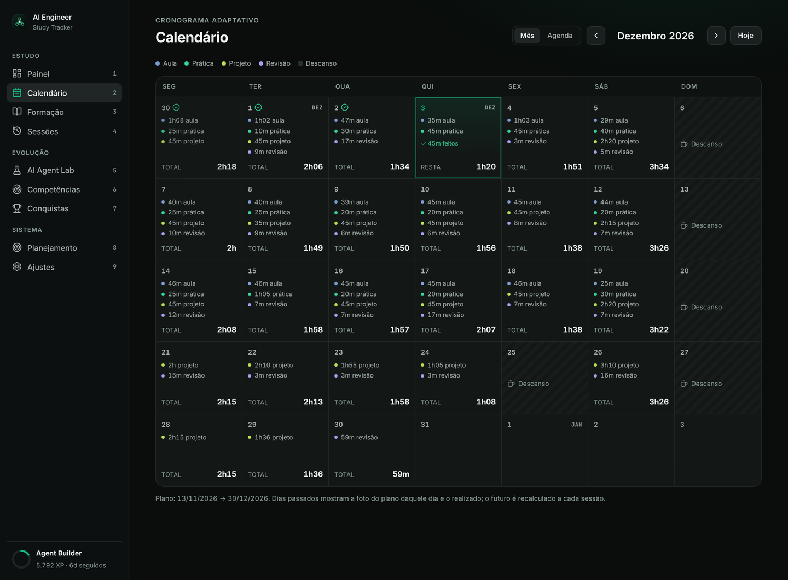
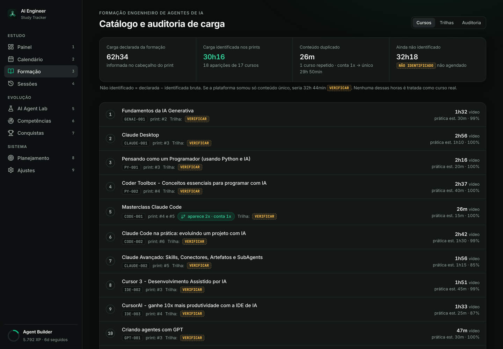
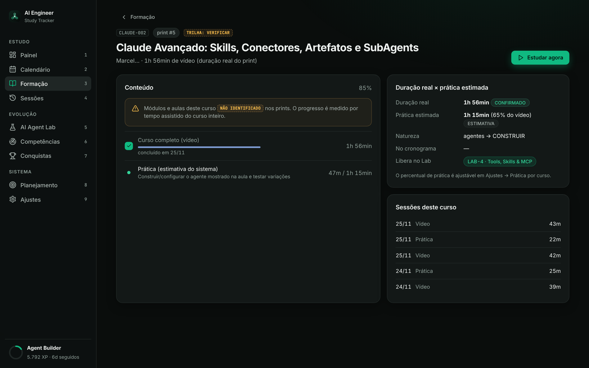

# AI Engineer Study Tracker

PWA pessoal e **local-first** para acompanhar a formação **Engenheiro de Agentes de IA** (62h34 de vídeo, 8 trilhas).
O app não é um checklist de aulas: ele organiza a formação no ciclo

**aprender → entender → construir → revisar → consolidar**

e transforma a formação em competências, projetos (AI Agent Lab) e evolução mensurável.


| | |
|---|---|
|  |  |
|  |  |

> Os prints usam um banco de **demonstração** (`scripts/demo_seed.py`) que simula 3 semanas de estudo.

## Planejamento (somente o conteúdo identificado nos prints)

| | |
|---|---|
| Carga declarada · identificada · duplicada · **não identificada** | 62h34 · 30h16 · 0h26 · **32h18 [NÃO IDENTIFICADO, não agendado]** |
| FORMAÇÃO (vídeo único) · PRÁTICA · PROJETOS · REVISÃO | 29h50 · 14h00 · 34h30 · 6h04 |
| **TEMPO TOTAL DE APRENDIZADO** | **84h24** |
| Período | 13/11/2026 → 28/12/2026 (fim do conteúdo identificado) |
| Dias de estudo · descanso · média · maior dia | 38 · 8 · 2h13 · 3h38 |

Trilhas: os prints não mostram nomes nem a associação curso↔trilha, então as 8 trilhas estão **A confirmar**.
Detalhes e classificação CONFIRMADO / INFERIDO / A VERIFICAR em [`docs/ANALISE.md`](docs/ANALISE.md); cronograma em [`docs/CRONOGRAMA.md`](docs/CRONOGRAMA.md).

## Funcionalidades

- **Painel**: progresso geral, horas por tipo, XP/nível, próximo estudo (com botão *Iniciar*), próximas revisões, Lab e trilhas.
- **Calendário** (mês e agenda): aula / prática / projeto / revisão / descanso por dia, planejado × realizado.
- **Formação**: 8 trilhas, cursos com ID único, carga bruta × única, sequência pedagógica de estudo, detalhe de curso com blocos/aulas.
- **Sessões**: registro manual (data, tipo, conteúdo, planejado, realizado, observações, status) e histórico editável.
- **Focus Mode**: timer com pausa, que persiste ao recarregar a página. Ao finalizar, registra a sessão, concede XP e atualiza progresso e plano.
- **Cronograma adaptativo**: cada sessão recalcula **apenas o futuro**. Atrasos são redistribuídos e adiantamentos antecipam conteúdos. O histórico (sessões e a "foto" do plano de cada dia) é preservado.
- **Revisão espaçada** D+1 / D+7 / D+30, curta (≈15 min/dia), gerada a partir do que você realmente estudou.
- **AI Agent Lab**: 9 estágios. Cada um tem objetivo, competências, tarefas, implementação, milestones, status e notas com salvamento automático.
- **Competências**: 10 competências com base no conhecimento prévio e evidências de conteúdo, prática, projetos e revisões, mais um radar.
- **Gamificação**: XP por minuto em que fazer vale mais que assistir (vídeo 1×, revisão 1,5×, prática 2×, projeto 2,5×), 6 níveis e 19 conquistas.
- **Dados**: backup/restauração do SQLite, exportação/importação em JSON e importação do catálogo.
- **PWA**: instalável no Windows e no Android, com ícone, splash, atalhos, uso offline (app shell + últimos dados), responsivo e navegação por toque.

## 1. Instalação (Windows)

Pré-requisito: [Python 3.10+](https://www.python.org/downloads/). Na instalação, marque **"Add python.exe to PATH"**.

1. Baixe/clone esta pasta (`ai-study-tracker`).
2. Dê duplo clique em **`install.bat`**. Ele cria `.venv` e instala as dependências.

## 2. Execução

Duplo clique em **`start.bat`**. O navegador abre em <http://localhost:8000>.
Para encerrar, feche a janela ou pressione `Ctrl+C`.

Linux/macOS: `./start.sh`.

## 3. Acesso

| Onde | Como |
|---|---|
| Este PC | <http://localhost:8000> |
| Celular na mesma rede Wi-Fi (**qualquer dispositivo da rede passa a acessar o app, sem senha**) | `start.bat --lan` → abra o endereço `http://192.168.x.x:8000` exibido no terminal (libere a porta 8000 no Firewall do Windows quando ele perguntar) |

Atalhos de teclado: `1`–`9` navegam entre as telas e `f` abre o Focus Mode.

## 4. Backup

- **`backup.bat`** cria `database\backups\backup-AAAAMMDD-HHMMSS.db`. Funciona com o app aberto e mantém os 30 backups mais recentes.
- No app, em **Ajustes → Dados locais**: *Backup (.db)* (download) e *Exportar JSON*.

## 5. Restauração

- **`restore.bat database\backups\backup-....db`**: feche o `start.bat` antes. Um backup de segurança do estado atual é criado automaticamente.
- No app, em **Ajustes → Restaurar backup** (arquivo `.db`) ou **Importar JSON**. O arquivo é validado (formato, integridade e tabelas) antes de substituir os dados.

## 6. Instalação como PWA

**Windows (Chrome ou Edge):** com o app aberto em `localhost:8000`, clique no ícone **Instalar** na barra de endereço (ou em *Ajustes → Instalar*). O app ganha ícone no Menu Iniciar/área de trabalho e abre em janela própria.
O servidor (`start.bat`) precisa estar rodando. Para iniciá-lo junto com o Windows, coloque um atalho do `start.bat` em `shell:startup`.

**Android (Chrome):** o Chrome só instala um PWA completo (com service worker e uso offline) em **HTTPS** ou `localhost`. Há duas opções:

1. **HTTPS na rede local (recomendado)**
   ```
   winget install FiloSottile.mkcert
   mkcert -install
   mkdir certs
   mkcert -cert-file certs\cert.pem -key-file certs\key.pem localhost 127.0.0.1 192.168.x.x
   start.bat --lan --https
   ```
   No celular, instale a CA do mkcert (arquivo `rootCA.pem`, localizado com `mkcert -CAROOT`) em *Configurações → Segurança → Credenciais → Instalar certificado*. Depois abra `https://192.168.x.x:8000` e use **⋮ → Instalar app**.
2. **Via USB (sem certificado)**: ative a depuração USB, rode `adb reverse tcp:8000 tcp:8000` e abra `http://localhost:8000` no Chrome do celular.

Offline, o app abre pelo cache e mostra os últimos dados salvos. Para registrar sessões, o servidor do PC precisa estar acessível.

## Atualizar o catálogo (quando chegarem os prints que faltam)

Nos prints atuais **não** aparecem: nomes das trilhas, a trilha de cada curso, módulos e aulas, e as 32h18 restantes.
Preencha `appearances[].track`, `tracks[].name/confirmed` ou adicione cursos/aulas reais em `data/catalog.json` e importe em **Ajustes → Catálogo**. Nunca invente: aula sem duração é rejeitada.
O progresso é preservado pelos IDs das aulas, e o plano, a carga única e a data final são recalculados.

```json
{
  "meta": { "name": "...", "status": "final", "declared_video": "62:34:00", "study_sequence": ["GENAI-001", "..."] },
  "tracks": [ { "id": "T1", "order": 1, "title": "Trilha 1", "name": "Nome confirmado", "confirmed": true } ],
  "contents": {
    "GENAI-001": {
      "title": "Fundamentos da IA Generativa", "nature": "conceitual", "practice_ratio": 0.3,
      "competencies": ["fundamentals", "prompt"],
      "appearances": [ { "track": "T1", "position": 2 } ],
      "modules": [ { "title": "Módulo 1", "lessons": [ { "id": "GENAI-001.M1.L01", "title": "Aula 1", "duration": "12:30" } ] } ]
    }
  }
}
```

Use o mesmo ID quando um curso aparece em várias trilhas: ele conta 1x na carga e no progresso.
Naturezas válidas: `conceitual`, `tecnico`, `ferramenta`, `agentes`, `projeto`.
Sem `modules`, informe só a `duration` real: o curso é uma unidade e o progresso é medido por tempo assistido.

## Arquitetura

```
ai-study-tracker/
├── backend/app/
│   ├── main.py           API FastAPI + arquivos estáticos do PWA
│   ├── planner.py        algoritmo de distribuição (função pura, testada)
│   ├── tracker.py        estado real, revisões, recálculo adaptativo, progresso
│   ├── catalog.py        validação/importação do catálogo, IDs únicos, bruto × único
│   ├── gamification.py   XP, níveis, conquistas, competências
│   ├── lab.py            AI Agent Lab
│   ├── services.py       agregações das telas
│   ├── backup.py         backup/restore SQLite, export/import JSON
│   ├── settings.py       rotina de estudo (capacidade por dia, descanso, feriados)
│   └── schema.sql
├── frontend/             PWA: HTML + CSS + JS (módulos ES, sem build), manifest, service worker, fontes e ícones locais
├── data/                 catalog.json (dos prints) e lab.json (estágios do laboratório)
├── database/             SQLite (study_tracker.db) e backups/ (não versionados)
├── docs/                 ANALISE.md, CRONOGRAMA.md, screenshots/
├── scripts/              run.py, backup.py, restore.py, export_schedule.py, demo_seed.py, make_icons.js
├── tests/                pytest (planejador, catálogo, API)
└── install.bat · start.bat · backup.bat · restore.bat · start.sh
```

**Escolhas técnicas.** O backend usa FastAPI + SQLite (local-first, um único arquivo de dados). O frontend é HTML/CSS/JS
puro com módulos ES: sem etapa de build, sem dependências de CDN e com fontes e ícones empacotados, então funciona offline.
O algoritmo de planejamento é uma função pura sobre o estado real, o que facilita testes e torna o recálculo
adaptativo determinístico.

## Desenvolvimento

```bash
python -m venv .venv && .venv/bin/pip install -r requirements-dev.txt
.venv/bin/python -m pytest              # 57 testes
python scripts/export_schedule.py       # regenera docs/CRONOGRAMA.md
python scripts/demo_seed.py --db database/demo.db --until 2026-12-03   # banco de demonstração
AST_DB=database/demo.db AST_TODAY=2026-12-03 python scripts/run.py      # roda com data simulada
```

Acessibilidade: `scripts/audit_a11y.js` (axe-core). Performance: `scripts/audit_perf.js`.

Variáveis: `AST_DB` (caminho do banco), `AST_TODAY` (simula a data de hoje), `AST_CATALOG`, `AST_BACKUP_DIR`.

Licenças de terceiros: fontes Inter e JetBrains Mono (OFL), ícones Lucide (ISC). Os arquivos estão em `frontend/fonts` e `frontend/icons`.
