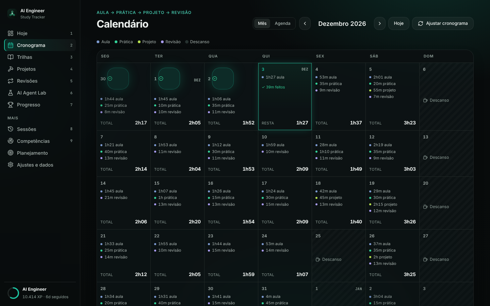
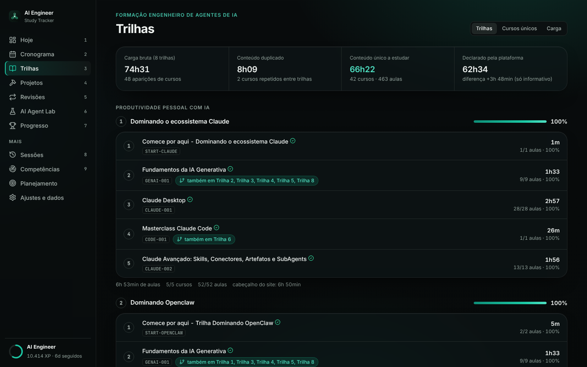
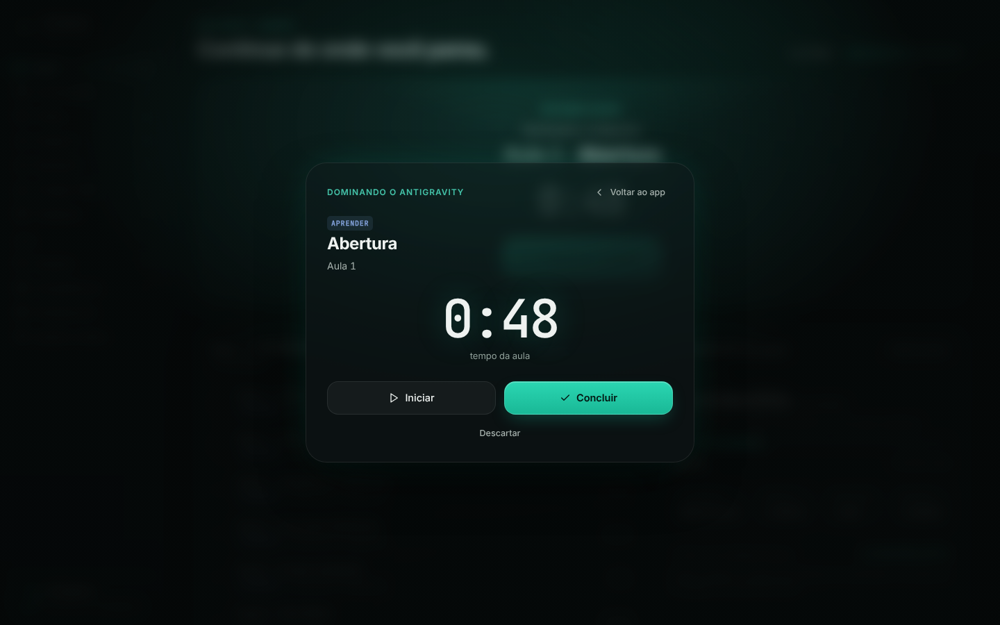

# AI Engineer Study Tracker

App pessoal e **local-first** para estudar a formação **Engenheiro de Agentes de IA**:
Formação → Trilhas → Cursos → Aulas, com plano diário, prática, projetos e revisão espaçada.
Funciona no **desktop e no celular** (PWA instalável, offline, dados salvos no seu computador).


| | |
|---|---|
|  |  |
|  |  |

> Os prints usam um banco de **demonstração** (`scripts/demo_seed.py`), não dados reais.

## Uso rápido

1. Instale o [Python 3.10+](https://www.python.org/downloads/) (marque *Add python.exe to PATH*) e dê duplo clique em **`install.bat`**.
2. Duplo clique em **`start.bat`** → abre <http://localhost:8000>.
3. Tela **Hoje** → **Começar estudo** → *Iniciar / Concluir*. Ao concluir: aula marcada, progresso, XP, sequência,
   revisão futura (D+1/D+7/D+30) e a próxima atividade carregada.

Navegação: Hoje · Cronograma · Trilhas · Projetos · Revisões · AI Agent Lab · Progresso (no celular, barra inferior).

## Instalar como app (PWA)

- **Desktop (Chrome/Edge):** com o `start.bat` rodando, abra `localhost:8000` e clique em **Instalar** na barra de endereço.
- **Celular:** o PWA exige HTTPS (ou localhost). Rode `start.bat --lan --https` (precisa de certificado, ex. `mkcert`),
  abra o endereço mostrado no celular, mesma rede Wi-Fi, e use *Adicionar à tela inicial*. Sem HTTPS o site abre no celular,
  mas não instala. O servidor padrão escuta só em 127.0.0.1.
- Dados ficam no computador (`database/study_tracker.db`); o celular acessa o mesmo servidor.

## O catálogo (fonte: player da plataforma)

| | |
|---|---|
| Trilhas | 8 (2 grupos) |
| Cursos únicos · aulas | 42 · 463 (462 obrigatórias + 1 aviso "em breve") |
| Carga bruta (soma das 8 trilhas) | 74h30m39s |
| Duplicado | 8h09m02s (*Fundamentos da IA Generativa* em 6 trilhas, *Masterclass Claude Code* em 2) |
| **Formação (conteúdo único)** | **66h21m37s** (soma das durações das aulas) |
| Sem duração (quiz, teste, guia, vídeo) | 56, contam 0 min e aparecem como "-" |

Duração do curso = soma das aulas (batem com os cards do site em 42/42 cursos; a trilha 8 diverge ~29 min do cabeçalho
do site e a divergência não foi explicada: vale a soma das aulas). Eletivos *Projetos para Professores* e *Para se aprofundar*
ficam fora; *Git e GitHub* é **opcional** (fora de progresso e plano). Curso repetido tem um cadastro só (progresso compartilhado).

## Cronograma (modelo VÍDEO → PRÁTICA → PROJETO → REVISÃO)

Início **13/11/2026** · última aula ~**09/01/2027** · fim do trabalho ~**13/01/2027** · revisões D+30 até ~08/02/2027 ·
51 dias de estudo · média 2h12 · máximo 3h30 · descanso aos domingos.
Rotina: Seg/Ter/Qui 2h15 · Qua 2h · Sex 1h45 · Sáb 3h30 (dia de projeto) · Dom descanso; 24/12 e 31/12 metade; 25/12 e 01/01 descanso.
Totais planejados: **Formação 66h21m37s** + Prática ~18h15 + Projetos ~18h + Revisão ~10h50 = **~113h25 de aprendizagem**.
**Prática, projetos e revisão são estimativas do planejador**; só a formação é duração real. O plano recalcula só o futuro (atrasos/adiantamentos).

## Funcionalidades

Hoje (Estudar agora + checklist) · Cronograma · Trilhas/Cursos/Aulas · sessão (Iniciar/Pausar/Concluir) ·
revisões · projetos (3 + final) · AI Agent Lab (9 etapas) · XP, 6 níveis, sequência e conquistas ·
competências · backup/restauração (.db) · exportação/importação (JSON) · PWA offline.

## Backup

`backup.bat`, `restore.bat <arquivo>` ou em *Ajustes e dados* (backup .db, restaurar, exportar/importar JSON).

## Testes

```bash
python -m venv .venv && .venv/bin/pip install -r requirements-dev.txt
.venv/bin/python -m pytest            # 79 testes
node scripts/e2e_flow.js http://localhost:8000/ out   # fluxo real no navegador (Playwright)
python scripts/build_catalog.py && python scripts/audit_durations.py && python scripts/export_schedule.py
```

Variáveis: `AST_DB`, `AST_TODAY`, `AST_CATALOG`, `AST_BACKUP_DIR`. Fonte: Inter (Aptos é proprietária e não vem junto).
Licenças: Inter e JetBrains Mono (OFL), ícones Lucide (ISC).
