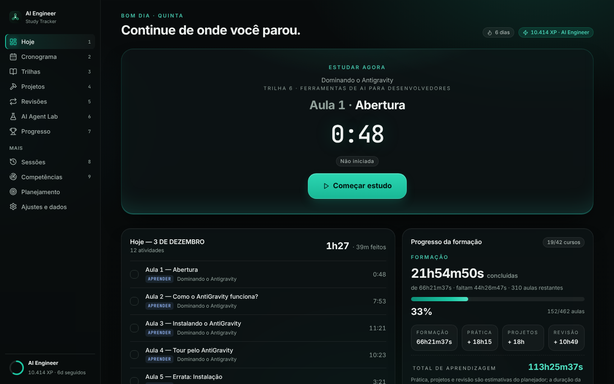
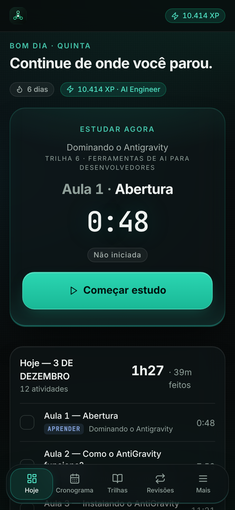
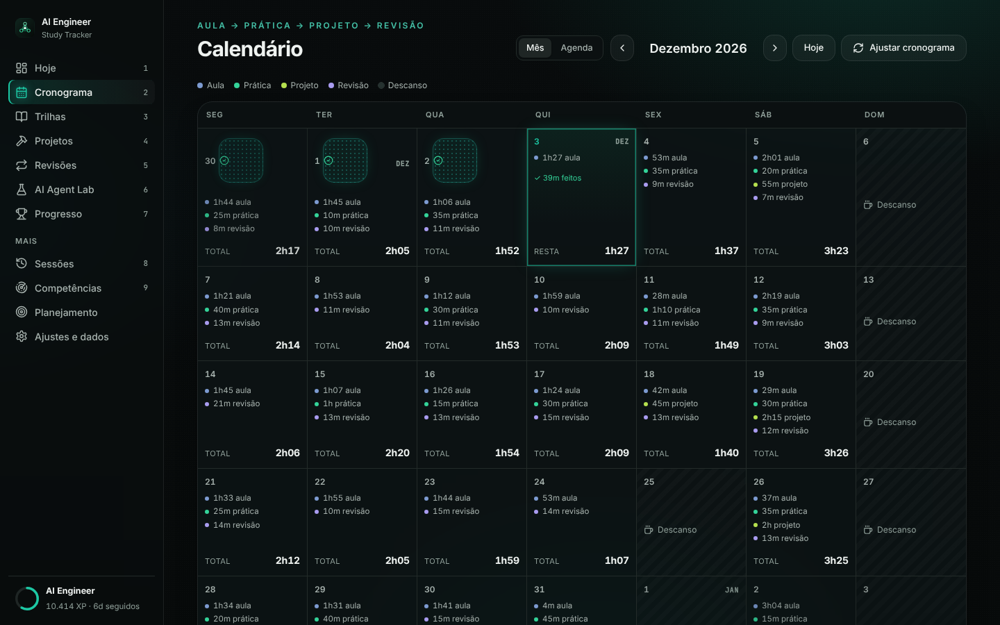

# AI Engineer Study Tracker

App pessoal e **local-first** para estudar a formação **Engenheiro de Agentes de IA**
(8 trilhas · 42 cursos · 463 aulas · **66h21m37s**). Mostra o que estudar hoje, registra o progresso (XP, sequência,
revisões D+1/D+7/D+30) e guarda tudo no seu computador. Funciona no desktop e no celular (PWA).



| | |
|---|---|
|  |  |

> Os prints usam um banco de **demonstração** (`scripts/demo_seed.py`), não dados reais.

## Como instalar (Windows, uma vez)

1. Instale o [Python 3.10+](https://www.python.org/downloads/) marcando **"Add python.exe to PATH"**
   (se não tiver, o `install.bat` tenta instalar sozinho pelo `winget`).
2. Dê duplo clique em **`install.bat`**. Ele cria o ambiente, instala os pacotes e oferece criar o **atalho na Área de Trabalho**.
   (Depois, `criar-atalho.bat` cria o atalho quando quiser.)

## Como iniciar (todos os dias)

**Duplo clique em `AI Engineer Study Tracker.exe`** (ou no atalho da Área de Trabalho).
Ele inicia o servidor local, espera responder e abre o navegador em <http://localhost:8000>.
Se já estiver aberto, só abre o navegador de novo (não cria outro servidor). Na primeira vez, se faltar o ambiente, ele roda o `install.bat`.

Para encerrar: **`Fechar AI Engineer Study Tracker.exe`** (ou `stop.bat`, ou Ajustes → *Encerrar o tracker*). Faz um backup antes.

## Backup e restauração

- **Automático:** ao abrir, a cada 6 h e ao encerrar, em `database/backups` (os 30 mais recentes de cada tipo; nada manual é apagado).
- **Botão:** Ajustes → **Exportar backup** (baixa um `.db`) e **Importar backup**. Antes de importar, o arquivo é validado e um
  backup de segurança do estado atual é criado; se o arquivo for inválido, nada muda.
- **Sem o app:** `backup.bat` e `restore.bat` (lista os backups e você escolhe; feche o tracker antes).
- Atualizar o código **não** apaga o banco (`database/study_tracker.db` não é versionado).

## Celular (PWA)

O PWA só instala em **HTTPS**. No PC: crie um certificado (ex.: `mkcert`), salve em `certs/cert.pem` e `certs/key.pem` e rode
`start.bat --lan --https`. No celular (mesma rede Wi-Fi) abra o endereço mostrado e use *Adicionar à tela inicial*.
Atenção: em modo `--lan` qualquer aparelho da rede acessa seus dados (não há senha). Por padrão o servidor escuta só neste PC.
No desktop: Chrome/Edge → ícone **Instalar** na barra de endereço (o servidor precisa estar ativo).

## O que tem

Hoje (Estudar agora + checklist) · Cronograma (adiar um dia → recalcula só o futuro) · Trilhas/Cursos/Aulas ·
sessão (Iniciar/Pausar/Concluir) · Revisões · Projetos · AI Agent Lab · XP, níveis e sequência · Ajustes (rotina, estimativas, backup).

**Formação × Prática × Projetos × Revisão:** só a formação (66h21m37s, soma das aulas) é duração real; os outros são estimativas
(~18h15, ~18h, ~10h50), editáveis em Ajustes. Plano: início 13/11/2026 · última aula 09/01/2027 · fim do trabalho 13/01/2027 · última revisão 08/02/2027.
Trilha 8: soma das aulas 27h20m11s × cabeçalho do site 26h51 (divergência documentada, vale a soma). Opcionais fora do plano: Git e GitHub, Projetos para Professores, Para se aprofundar.

## Desenvolvimento

```bash
python -m venv .venv && .venv/bin/pip install -r requirements-dev.txt
.venv/bin/python -m pytest                                  # testes
node scripts/e2e_flow.js http://localhost:8000/ out         # fluxo real no navegador (Playwright)
bash scripts/build_launcher.sh                              # recompila os .exe (Go)
python scripts/build_catalog.py && python scripts/audit_durations.py
```

Pastas: `backend/` (FastAPI + SQLite) · `frontend/` (PWA sem build) · `launcher/` (fonte do .exe, Go) · `data/catalog.json` · `docs/` · `tests/`.
Variáveis: `AST_DB`, `AST_TODAY`, `AST_CATALOG`, `AST_BACKUP_DIR`. Fonte Inter (OFL), ícones Lucide (ISC). Ideias futuras: `docs/FUTURE.md`.
