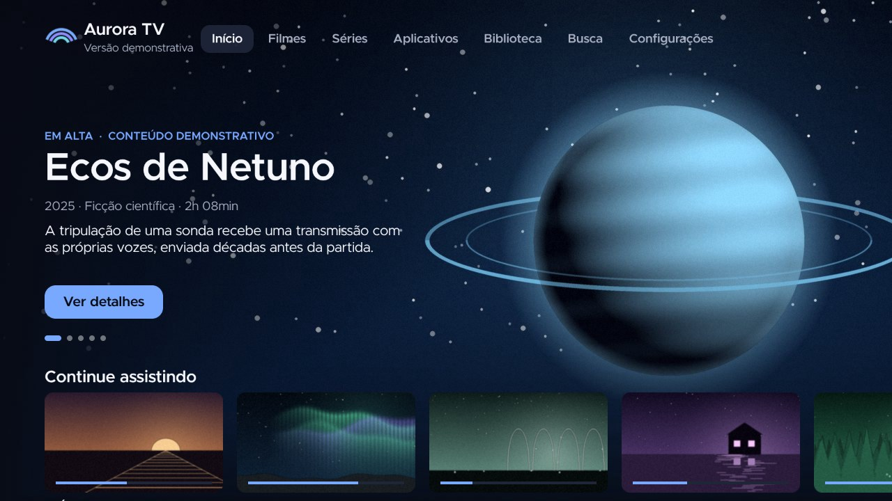

# Aurora Roku (Aurora TV)

Interface de entretenimento para **Roku Express 3960BR**, em **BrightScript + SceneGraph**, com
inspiração visual nas interfaces do Google TV e das TVs que o usam: banner em carrossel,
fileiras de recomendação, fileira de aplicativos e navegação 100% pelo controle remoto.

> É um **aplicativo independente**, iniciado pelo sistema Roku. **Não substitui a tela inicial
> do Roku**, não altera o sistema e não reproduz a interface proprietária do Google TV.
>
> **Versão demonstrativa (0.2.0).** Títulos, aplicativos, sinopses, anos, durações e progresso
> são **fictícios**, e todas as imagens são **arte original** gerada localmente. Não há
> streaming, contas, rede nem integração externa. **Nada foi instalado ou executado em um
> Roku físico.**



*Captura do **simulador brs-engine** (de terceiros), configurado como 3960X em 720p. Não é o
Roku OS; a renderização no aparelho pode diferir.*

## Estado atual

| Área | Estado |
|---|---|
| Tela inicial: carrossel de 5 banners, indicador de posição e 7 fileiras | Implementada; verificada no simulador |
| Abas: Início, Filmes, Séries, **Aplicativos**, **Biblioteca** (com Favoritos), **Busca**, Configurações | Implementadas |
| **Busca** com teclado na tela navegável por setas e resultados em tempo real | Implementada; verificada no simulador |
| Detalhes de título e de aplicativo, com Favoritar | Implementados |
| Navegação por setas, OK e Voltar, com restauração de foco | Implementada; 48 verificações no simulador |
| Favoritos, tema e opção de animações persistentes (registro do Roku) | Implementados; persistência verificada no simulador |
| Dois temas (Aurora Noturna / Aurora Boreal) | Implementados |
| Execução no Roku Express 3960BR | **Não testada** (fora do escopo desta etapa) |

## Tecnologias

- **BrightScript** e **SceneGraph (XML)**, nativos da plataforma. **Nenhuma biblioteca de
  terceiros vai no app.**
- Ferramentas de desenvolvimento (só no computador):
  - **BrighterScript `bsc`** e **bslint** (RokuCommunity): compilação, validação e lint;
  - **brs-cli** (brs-node): testes de lógica escritos em BrightScript;
  - **brs-engine + brs-scenegraph**: simulador de terceiros, executado no Chromium via
    Playwright;
  - **Python + Pillow/NumPy**: geração da arte original.

## Pré-requisitos

- Node.js 20 ou superior e npm.
- Python 3 com Pillow e NumPy (só para regenerar a arte).
- Opcional, para o simulador: Playwright com Chromium já instalado (não é dependência do
  projeto). Defina `NODE_PATH` se estiver instalado globalmente.

## Preparar e executar

```bash
cd aurora-roku
npm install                  # ferramentas de desenvolvimento (nada vai para o aparelho)
npm test                     # bsc + bslint + verificadores do projeto e da documentação + testes de lógica
npm run simulate             # executa o app no simulador (roteiro de 48 verificações) e salva capturas
python3 tools/package.py     # gera out/aurora-tv.zip (somente o app: manifest, source, components, images)
npm run package:source       # gera dist/aurora-roku-source-<versão>.zip (código, recursos e documentação)
python3 tools/generate_assets.py   # regenera a arte (determinística)
```

Para editar, qualquer editor serve; a extensão BrightScript para VS Code (RokuCommunity) usa o
mesmo `bsconfig.json`. **Este repositório não contém comandos que enviem o pacote a um
aparelho.** O procedimento futuro, sob autorização, está em [TEST_PLAN.md](TEST_PLAN.md).

## Estrutura

```
aurora-roku/
├── manifest                      # metadados do app (lido pelo Roku)
├── source/                       # thread principal
│   ├── main.brs                  # cria a cena, publica o estado global e grava no registro
│   ├── Persistence.brs           # roRegistrySection (tema, animações, favoritos)
│   └── shared/                   # lógica pura: usada pelos componentes E pelos testes
│       ├── Theme.brs             # identidade: nome, temas, cores, tipografia, imagens de UI
│       ├── DemoContent.brs       # catálogo DEMONSTRATIVO (20 títulos, 8 aplicativos, fileiras)
│       ├── NavigationLogic.brs   # máquina de estados da navegação + movimento em grade
│       ├── SearchLogic.brs       # teclado, filtro e textos da Busca
│       ├── AppStateLogic.brs     # regras de favoritos e validação do estado salvo
│       └── Util.brs
├── components/                   # thread de renderização (SceneGraph)
│   ├── MainScene.xml/.brs        # raiz: camadas, Voltar, foco barra ↔ conteúdo
│   ├── NavigationBar.xml/.brs    # marca + 7 abas
│   ├── HomeScreen.xml/.brs       # banner + fileiras, recolhimento animado
│   ├── HeroSection.xml/.brs      # carrossel de banners + indicador
│   ├── CatalogScreen.xml/.brs    # Filmes, Séries, Aplicativos e Biblioteca (um componente)
│   ├── SearchScreen.xml/.brs     # Busca: teclado + resultados
│   ├── DetailsScreen.xml/.brs    # camada de detalhes (título ou aplicativo)
│   ├── SettingsScreen.xml/.brs   # tema, animações, limpar favoritos, diagnóstico
│   ├── ContentCard.xml/.brs      # item dos RowList (cartão 16:9)
│   ├── PillButton.xml/.brs       # abas, botões, opções e teclas
│   ├── Toast.xml/.brs            # avisos curtos
│   └── shared/                   # Ui.brs (fontes, tema, favoritos), ContentBuilder.brs
├── images/                       # arte original gerada: posters/, backgrounds/, ui/<tema>/, brand/
├── tests/
│   ├── unit/LogicTests.brs       # 81 testes de lógica pura
│   └── manual-test-checklist.md  # checklist para o Roku físico (não executado)
├── tools/                        # gerador de arte, verificadores, empacotadores, simulador
│   └── simulator/                # harness do brs-engine + scenario.js (roteiro)
├── docs/screenshots/             # capturas do simulador
└── README.md · SOURCES.md · PLATFORM_COMPATIBILITY.md · DESIGN_SYSTEM.md · TEST_PLAN.md · FINAL_REPORT.md
```

Não há uma pasta de dados separada: o conteúdo demonstrativo fica em `source/shared/DemoContent.brs`, um
arquivo BrightScript puro. Isso permite usar os mesmos dados nos componentes e nos testes, sem
ler arquivos em tempo de execução. Para trocar o conteúdo, edite só esse arquivo.

### Pontos de entrada

| Ponto | Arquivo | Papel |
|---|---|---|
| Entrada do app | `source/main.brs` → `Main()` | Cria `roSGScreen`, carrega o estado, cria `MainScene` |
| Cena raiz | `components/MainScene.brs` | Cria as telas, trata Voltar e a passagem de foco |
| Dados | `source/shared/DemoContent.brs` | Única fonte de conteúdo |
| Identidade | `source/shared/Theme.brs` | Nome, cores, tipografia |

## Arquitetura e foco

- **Um dono do foco por região.** O `RowList` nativo trata as setas dentro das fileiras;
  `HeroSection`, `DetailsScreen`, `SettingsScreen`, `NavigationBar` e `SearchScreen` tratam as
  próprias setas e o OK. Teclas não tratadas sobem pela cadeia de foco até o `MainScene`.
- **Só o `MainScene` trata o Voltar** e a passagem de foco entre a barra de abas e o conteúdo.
  As decisões vêm de `NavigationLogic.brs`, uma lógica pura e testada.
- As pílulas **nunca** recebem foco do sistema: o componente pai as realça.
- A Busca usa um **nó de foco próprio para o teclado**, irmão do `RowList` de resultados. A troca
  entre os dois é sempre um `setFocus` entre irmãos (dar foco a um ancestral do nó já focado
  não funcionou no simulador, defeito encontrado e corrigido nos testes).
- **Restauração de foco:** os detalhes abrem como camada sobre a aba. Ao voltar, a aba devolve
  o foco ao `RowList`, que preserva o item focado.
- **Estado global:** `m.global.themeId`, `favorites` e `animations`. A thread principal observa
  esses campos e grava no registro. As telas descartáveis liberam os observadores
  (`unobserveFieldScoped`) em `dispose()`.
- **Memória:** só a tela Início fica criada o tempo todo; as demais são criadas a cada visita e
  removidas ao sair. Só um fundo de tela cheia é carregado por vez.

### Máquina de estados de navegação

Estado: `tab` (aba ativa), `zone` (`nav` = barra de abas, `content` = conteúdo,
`overlay` = detalhes) e `overlay` (`none` ou `details`).

```
                    ┌───────────── OK num cartão/banner ─────────────┐
                    │                                                ▼
 [nav] ──Baixo──▶ [content] ◀────────── Voltar ───────────── [overlay: details]
   ▲  ◀──Cima (topo)──┘                                   (fecha e restaura o foco)
   │
   │  OK numa aba: troca a aba e mantém o foco em [nav]
   │
 Voltar:
   overlay aberto ............................ fecha os detalhes   → [content]
   aba ≠ Início (nav ou content) ............. volta ao Início      → [nav]
   Início, content ........................... sobe para a barra   → [nav]
   Início, nav ............................... não trata: o Roku encerra o app
 Home: tratado pelo sistema Roku (o app não intercepta)
```

Regiões dentro de cada aba (todas dentro de `content`):

| Aba | Regiões e teclas |
|---|---|
| Início | **Banner** (esquerda/direita trocam o banner, OK abre detalhes) ⇄ **fileiras** (Baixo/Cima). Cima no banner sobe para a barra |
| Filmes, Séries, Aplicativos, Biblioteca | Fileiras (`RowList`). Cima na primeira fileira sobe para a barra |
| Busca | **Teclado** (grade 4×9 + linha com Espaço/Apagar) ⇄ **resultados** (Baixo na última linha / Cima). Cima na primeira linha do teclado sobe para a barra |
| Configurações | 3 opções em coluna. Cima na primeira sobe para a barra |

Garantias verificadas por teste: Voltar repetido sempre termina no encerramento, em no máximo
3 passos e sem ciclos; as 38 teclas do teclado são alcançáveis só com as setas; nas pontas,
esquerda/direita são consumidas e o foco não "escapa".

## Funcionalidades

### Implementadas (executam no simulador)

- Banner em carrossel **manual** (5 banners), com indicador de posição e fundo que acompanha o
  banner. Sem avanço automático.
- 7 fileiras na Início: Continue assistindo, Em alta, Filmes para você, Séries para você,
  Ficção científica e fantasia, Recomendados e Seus aplicativos.
- Filmes, Séries e Aplicativos em fileiras por categoria, com painel de informações do item
  focado. Biblioteca com progresso, **Favoritos** (atualizam na hora) e salvos.
- **Busca:** teclado próprio (A–Z, 0–9, Espaço, Apagar), sem acentos e sem diferenciar
  maiúsculas, por título, gênero ou tipo; sugestões quando vazio e estado "nenhum resultado".
- Detalhes com ação principal contextual e botão de favoritar.
- Configurações: tema, **animações ligadas/desligadas**, limpar favoritos e diagnóstico real do
  aparelho (modelo, Roku OS, resolução).
- Dados incompletos ou inexistentes não derrubam a interface (itens ignorados).

### Demonstrativas (dados ou comportamentos fictícios, sempre identificados na interface)

- **Todo o catálogo**: títulos, séries, aplicativos, anos, sinopses, durações e progresso.
- **"Assistir"/"Continuar" não reproduz nada** e **"Abrir" não abre nenhum aplicativo**: cada um
  mostra um aviso de "Conteúdo demonstrativo".
- Selo "Versão demonstrativa" sempre visível na barra superior.

### Ainda não comprovadas ou fora do escopo

- Execução no Roku Express 3960BR (fontes reais, cantos dos botões, desempenho, memória).
- Abrir outros canais/aplicativos, reprodução de vídeo, DRM, contas, rede, voz.
- Substituir a tela inicial do Roku (não é possível por um app e não é objetivo).

## Documentos

- [FINAL_REPORT.md](FINAL_REPORT.md): relatório final desta entrega.
- [SOURCES.md](SOURCES.md): fontes, datas, leitura direta × resumo de busca, origem das imagens.
- [PLATFORM_COMPATIBILITY.md](PLATFORM_COMPATIBILITY.md): cada requisito classificado.
- [DESIGN_SYSTEM.md](DESIGN_SYSTEM.md): cores, tipografia, cartões, banner, foco e regras.
- [TEST_PLAN.md](TEST_PLAN.md): testes, procedimentos, resultados esperados e observados.
- [tests/manual-test-checklist.md](tests/manual-test-checklist.md): checklist para o Roku físico.
