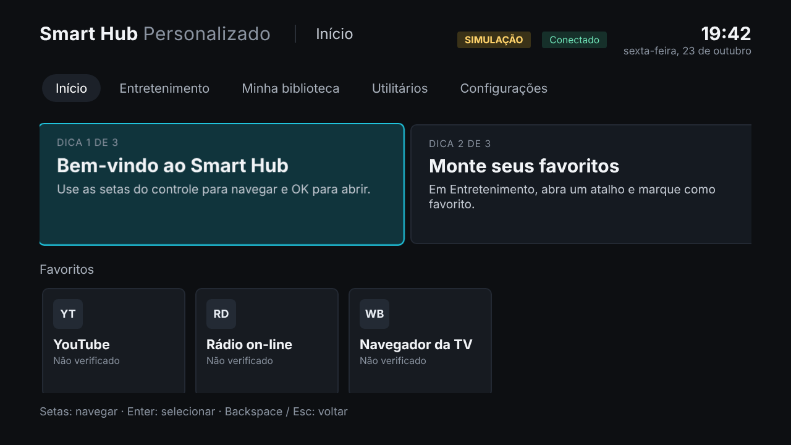

# Smart Hub Personalizado

Interface de "dez pés" (10-foot UI) para modernizar a navegação da Smart TV
**Samsung UN48H4203AG** (série H, 2014). O controle é feito pelo controle remoto e a
prioridade é preservar o funcionamento original da TV.



## Estado atual

| Fase | Estado |
|---|---|
| 1. Investigação da plataforma | **Concluída, com pendências**: [docs/FEASIBILITY.md](docs/FEASIBILITY.md) |
| 2. Arquitetura | **Definida**: [docs/ARCHITECTURE.md](docs/ARCHITECTURE.md) |
| 3–5. Design e protótipo no computador | **Funcional** (pasta `prototype/`) |
| 6. Testes | **Unitários, ES5 e ponta a ponta aprovados no PC**: [docs/TEST_PLAN.md](docs/TEST_PLAN.md) |
| 7. Implantação na TV | **Sem método comprovado**: [docs/DEPLOYMENT.md](docs/DEPLOYMENT.md) |

> **Nenhuma modificação foi feita na televisão.** O protótipo roda num navegador de
> computador e **não comprova** compatibilidade com a TV.

## Equipamento-alvo

| Item | Valor |
|---|---|
| Modelo | UN48H4203AG (etiqueta: UN48H4203AGXZD) |
| Software | T-NT14MUABC-1090.0 (família de firmware NT14M, série H/2014) |
| Hardware | TD02 |
| Plataforma | Samsung legada (pré-Tizen, "Orsay"): **provável**, não confirmada no modelo |

## Tecnologias

- HTML, CSS e **JavaScript ES5** puro, sem framework e sem etapa de build. O nível de JS da
  TV é desconhecido, então o código é o mais conservador possível.
- Camada de **adaptador de plataforma** que separa a interface das APIs da TV.
- Desenvolvimento: Node.js ≥ 20 (testes com `node:test`), `acorn` (verificação ES5) e,
  opcionalmente, Playwright (testes ponta a ponta).

## Pré-requisitos

- Um navegador moderno, para usar o protótipo.
- Node.js 20 ou superior, apenas para testes e para o servidor local.

## Como executar o protótipo

Opção 1 (sem instalar nada): abra `prototype/index.html` no navegador.

Opção 2 (servidor local, só em `127.0.0.1`):

```bash
cd smart-hub-personalizado
npm run serve          # http://127.0.0.1:8080
```

## Como testar a navegação

O teclado simula o controle remoto. **Não use o mouse.**

| Controle remoto | Teclado |
|---|---|
| Direcionais | Setas |
| OK | Enter |
| Return / Voltar | Backspace ou Esc |

Roteiro rápido:

1. Suba até a barra de abas, vá até **Entretenimento** e pressione Enter.
2. Desça até um atalho, pressione Enter e escolha **Adicionar aos favoritos**.
3. Pressione Voltar e veja que o foco volta ao mesmo cartão.
4. Em **Configurações**, mude a cor de destaque e recarregue a página. A preferência
   continua salva.
5. Em **Configurações → Simulação**, ligue a "Biblioteca de demonstração" ou "Simular
   falha" e abra **Minha biblioteca**.

## Testes automatizados

```bash
cd smart-hub-personalizado
npm install            # instala apenas o acorn (dependência de desenvolvimento)
npm test               # unitários + verificação de compatibilidade ES5/CSS
npm run test:e2e       # ponta a ponta (requer Playwright já instalado, ver abaixo)
```

O Playwright **não** é dependência do projeto, porque é grande e baixa navegadores. Para os
testes ponta a ponta, use uma instalação existente (`NODE_PATH=<pasta global> npm run
test:e2e`) ou instale-o com `npm i -D playwright`. As capturas de tela ficam em
`prototype/tests/e2e/output/`.

## Funcionalidades

### Implementadas (funcionam no protótipo)

- Telas: **Início**, **Entretenimento**, **Minha biblioteca**, **Utilitários** e
  **Configurações**, além das telas de detalhe (atalho, relógio, calendário, conectividade,
  diagnóstico, sobre).
- Navegação completa por teclado: foco visível, sem perda de foco, memória de coluna,
  retorno com o foco restaurado e controle de repetição ao segurar uma tecla.
- Preferências persistentes e validadas: cor de destaque (ciano ou azul), texto grande,
  animações e favoritos.
- Relógio, data e calendário em português, sem internet.
- Indicador de conexão e funcionamento offline.
- Registro de diagnóstico em memória e estados de erro que não travam a interface.
- Tela lógica 1280×720 escalada para qualquer janela, com margens de área segura.
- `prototype/diagnostics.html`: página de detecção de recursos e captura de teclas, para o
  primeiro teste no navegador da TV.

### Simuladas (dados ou comportamentos fictícios, sempre identificados na interface)

- Adaptador de plataforma: **navegador de computador** (selo "SIMULAÇÃO" no cabeçalho).
- Catálogo de serviços: atalhos **informativos**, sem abrir apps nem reproduzir conteúdo.
- Biblioteca de mídia: vazia por padrão. Há um modo de **demonstração** com itens fictícios
  e um modo de **falha simulada**.
- Teclas: códigos do teclado do PC, e não do controle.

### Ainda não comprovadas

- Execução na TV, seja pelo navegador ou como app de usuário.
- Códigos das teclas do controle remoto.
- Persistência (`localStorage`) na TV.
- Abertura de aplicativos nativos e acesso a mídia (USB/DLNA).
- Substituir o Smart Hub original ou definir este app como tela inicial (não há evidência
  de que seja possível sem modificar o firmware).

## Limitações conhecidas

- A loja Samsung não aceita mais apps para modelos 2014.
- Há indício oficial de que a Netflix não funciona em TVs Samsung de 2014. Os demais
  serviços não foram verificados.
- A investigação não conseguiu acessar diretamente os sites da Samsung, do SamyGO e do
  Internet Archive. Ver [research/SOURCES.md](research/SOURCES.md).

## Estrutura

```
smart-hub-personalizado/
├── README.md
├── package.json              scripts de teste/servidor; devDependency: acorn
├── docs/                     viabilidade, arquitetura, compatibilidade, segurança, testes, implantação
├── research/SOURCES.md       fontes, datas de acesso e limitações da coleta
├── prototype/
│   ├── index.html            protótipo
│   ├── diagnostics.html      diagnóstico para o navegador da TV
│   ├── styles/               CSS conservador (sem flex/grid/variáveis)
│   ├── scripts/              core/ data/ platform/ ui/ screens/ app.js (ES5)
│   └── tests/                unit/ (node:test) e e2e/ (Playwright)
├── platform/                 adaptador da TV (rascunho NÃO testado)
└── tools/                    verificador ES5/CSS e servidor local
```

## Próximas etapas

1. Reler manualmente as fontes oficiais bloqueadas (P-01). Localizar o SDK 5.1 e o manual
   do modelo (P-02, D-01).
2. **Com autorização:** testes H-01 a H-05 pelo navegador da TV, sem instalar nada
   ([DEPLOYMENT.md](docs/DEPLOYMENT.md)).
3. Atualizar [PLATFORM_COMPATIBILITY.md](docs/PLATFORM_COMPATIBILITY.md) com os resultados
   e ajustar o adaptador.
4. Só então avaliar o User App Sync oficial, com o SDK em máquina virtual isolada.
